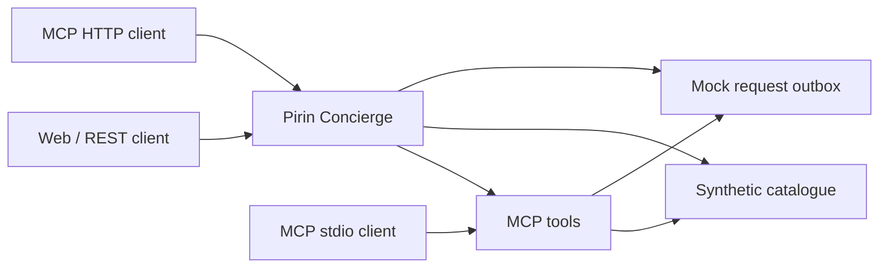

# Pirin Concierge

[](https://github.com/maxqmaxx/pirin-concierge/actions/workflows/ci.yml)

An open laboratory reference implementation for discovering rural experiences near Bansko and Razlog, Bulgaria. It connects a synthetic catalogue, Schema.org/JSON-LD, REST/OpenAPI, deterministic concierge responses and four Model Context Protocol (MCP) tools.

**Laboratory integration has been exercised.** On 13 September 2026, a fresh locked installation passed 28 tests, formatting, lint, types, OpenAPI validation and build. Additional checks ran the built HTTP server and the built stdio server as separate processes, called all four MCP tools through both transports, and observed a pending request through the HTTP outbox.

## Evidence for reviewers

| Evidence | Observed result | Inspect |
|---|---|---|
| Automated suite | 28/28 tests; all verification gates passed | [Evidence record](docs/trl4-evidence.md), [CI](https://github.com/maxqmaxx/pirin-concierge/actions/workflows/ci.yml) |
| Real HTTP and stdio entry points | Both passed; four MCP tools each; protocol 2026-07-28 negotiated | [Transport transcript](docs/evidence/2026-09-13/transport-transcript.json) |
| Discovery and request handoff | Synthetic catalogue results, JSON-LD seller, source-linked answers and pending request | [Laboratory transcript](docs/evidence/2026-09-13/lab-transcript.json) |
| Negative checks | Payment/confirmation fields, non-synthetic email domains and missing experiences rejected | Transport transcript and contract tests |
| Coverage | 87.45% lines, 77.44% branches; entry points checked separately by transport smoke test | [Coverage data](docs/evidence/2026-09-13/coverage-summary.json) |
| Dependency audit | 0 reported vulnerabilities on 13 September; includes development dependencies | [Audit output](docs/evidence/2026-09-13/dependency-audit.json) |
| Earlier laboratory baseline | 6 September run against source commit 91c782c | [Historical transcript](docs/evidence/2026-09-06/transcript.json) |

The [dated evidence pack](docs/evidence/2026-09-13/README.md) records source checksums and the distinction between local observations and CI. GitHub Actions repeats the checks in a clean Node 20 environment and attaches transcripts, coverage and audit results to the workflow run for its exact commit.

## What this establishes

This is evidence for a bounded, application-stage **TRL 4 laboratory integration**. The catalogue, people and requests are synthetic. The concierge uses deterministic retrieval; no generative model is exercised. MCP clients are explicitly connected.

It does not establish production readiness, generative-model quality, real host notifications, actual bookings, independent certification, regional adoption or organic discovery by consumer assistants. Controlled validation with authorised hosts and relevant regional data is the route to TRL 5/6.

## Reproduce the checks

Requires Node.js **20.19 or newer** and npm.

```bash
npm ci
npm run verify
npm run test:transports
npm run evidence:record
npm audit --audit-level=high
```

The transport check starts disposable processes on loopback and closes them after the scenario. It requires permission to bind a local TCP port. It contacts no external AI provider or real host.

To save machine-readable observations:

```bash
npm run test:transports -- --output .tmp/transport-transcript.json
npm run evidence:record -- --output .tmp/lab-transcript.json
```

For an interactive local HTTP server:

```bash
npm run build
npm start
```

Then open http://127.0.0.1:3000. The [demo walkthrough](docs/demo-script.md) describes the interfaces and expected observations.

## Request-only commercial model

The independent host remains the seller. A request is an expression of interest; the host must confirm availability and agree any transaction outside this laboratory demonstrator.

```json
{
  "status": "pending_host_confirmation",
  "requiresHostConfirmation": true,
  "paymentCollected": false,
  "automaticallyConfirmed": false
}
```

The mock outbox exposes request status without visitor contact details. The service accepts only synthetic email domains for demonstration requests and rejects unsupported payment or confirmation fields.

## Interfaces and architecture



- Catalogue/search: `GET /api/v1/experiences`, `GET /api/v1/experiences/search`, `GET /api/v1/experiences/{id}`.
- Concierge: `POST /api/v1/concierge/search`.
- Requests: `POST /api/v1/booking-requests`; inspection: `GET /api/v1/demo/outbox`.
- Contract: `GET /openapi.yaml`; metadata: experience-page JSON-LD.
- MCP HTTP: `/mcp`; built stdio entry point: `node dist/mcp-stdio.js`.
- MCP tools: `search_experiences`, `get_experience`, `list_by_area`, `initiate_booking_request`.

See [architecture](docs/architecture.md), [OpenAPI](openapi/openapi.yaml), [data model](docs/data-model.md) and [threat model](docs/threat-model.md).

## Data and licensing

Use synthetic data only. Do not add real host/customer contacts, booking records, survey responses, private application material or unlicensed media. The future regional pilot requires its own data arrangements; this repository does not prescribe its eventual cloud provider or transfer destinations. See [privacy](PRIVACY.md) and [security](SECURITY.md).

Code, schemas, contracts and deployment examples use Apache-2.0. Original documentation and the synthetic dataset use CC BY 4.0. Third-party licences remain applicable. Pre-existing proprietary Calivina components are outside this reference layer; see [open-source scope](docs/open-source-scope.md).

This repository may support a SMART ERA application. It does not claim a grant award, EU funding, SMART ERA endorsement or certification.
