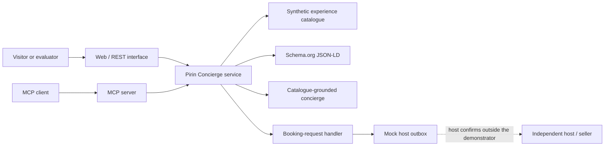

# Pirin Concierge

Pirin Concierge is an **application-stage TRL 4 laboratory demonstrator** for discovering rural experiences in Bulgaria's Pirin area through a small web/API catalogue, machine-readable metadata, and Model Context Protocol (MCP) tools.

> **Status:** This repository is being prepared as technical evidence for an application. It uses synthetic demonstration data only. A public deployment, CI run, and TRL 4 verification must not be assumed until the evidence table below contains dated links and commit identifiers.

## Evaluator overview

| Question | Answer |
|---|---|
| What is demonstrated? | Catalogue discovery, grounded concierge responses, Schema.org/JSON-LD publication, OpenAPI access, MCP access, and initiation of a booking **request**. |
| What is deliberately excluded? | Payments, checkout, escrow, package sales, automatic confirmation, and production host/customer data. |
| Who is the seller? | The independent host. Pirin Concierge is a discovery and request-routing layer, not the seller. |
| What data is included? | A synthetic, representative demo catalogue. It contains no real host, traveller, booking, survey, or application data. |
| What is the maturity claim? | Target evidence for an application-stage TRL 4 laboratory demonstrator. TRL 5 and TRL 6 require validation and demonstration with authorised participants in the Pirin region. |
| Is this the complete Calivina product? | No. This is a bounded open-source reference demonstrator. Proprietary Calivina components are outside this repository and licence grant. |

## Verification status

The following table is intentionally conservative. Replace every `TODO` only after the linked artefact has been generated from the exact release commit.

| Evidence | Status | Verifiable reference |
|---|---|---|
| Source and synthetic catalogue | Locally verified; CI pending | [`data/demo/`](data/demo/), [local verification](docs/evidence/local-verification-2026-08-30.md) |
| Automated test result | **Local PASS — CI pending** | [28/28 tests and coverage](docs/evidence/local-verification-2026-08-30.md), `TODO: CI_RUN_URL` |
| Reproducible release | **TODO — not yet published** | `TODO: RELEASE_URL` |
| Public laboratory deployment | **TODO — not yet verified** | `TODO: DEMO_URL` |
| MCP client demonstration | Official client contract tests pass locally; recording pending | [local verification](docs/evidence/local-verification-2026-08-30.md), `TODO: VIDEO_URL` |
| Dated TRL 4 evidence record | Template; observations pending | [`docs/trl4-evidence.md`](docs/trl4-evidence.md) |

## Safety and commercial boundary

The demonstrator enforces a request-only model:

- `initiate_booking_request` records or routes an expression of interest;
- the resulting state is `pending_host_confirmation`;
- `requiresHostConfirmation` is `true`;
- `paymentCollected` is `false`;
- `automaticallyConfirmed` is `false`;
- only the host can confirm availability and agree a transaction with the visitor;
- no payment credentials are accepted or stored.

The API response is expected to preserve this invariant:

```json
{
  "status": "pending_host_confirmation",
  "requiresHostConfirmation": true,
  "paymentCollected": false,
  "automaticallyConfirmed": false
}
```

## Target architecture



This is the target reference architecture. Its implementation and deployed behaviour must be checked against the release-specific evidence before citing it as completed. See [`docs/architecture.md`](docs/architecture.md).

## Public interfaces

The intended REST surface is:

- `GET /health`
- `GET /api/v1/experiences`
- `GET /api/v1/experiences/{id}`
- `GET /api/v1/experiences/search`
- `POST /api/v1/concierge/search`
- `POST /api/v1/booking-requests`
- `GET /api/v1/demo/outbox`
- `GET /openapi.yaml`
- `ALL /mcp` for the MCP HTTP transport

The intended MCP tools are:

- `search_experiences`
- `get_experience`
- `list_by_area`
- `initiate_booking_request`

The checked-in OpenAPI document and MCP tool schemas are authoritative for the exact parameters of a given commit.

## Quick start

Prerequisites: Node.js 20 or newer and npm.

```bash
npm ci
npm test
npm run dev
```

In a separate terminal, start the local stdio MCP transport:

```bash
npm run mcp:stdio
```

Do not infer that these commands pass on a published release until a green CI run for the same commit is linked in [Verification status](#verification-status).

## Evaluation path

1. Validate the repository with `npm ci` and `npm test`.
2. Inspect the synthetic catalogue and its JSON Schema validation.
3. Open the generated API documentation from `openapi/openapi.yaml`.
4. Connect an MCP Inspector or another standards-compliant client explicitly to this server.
5. Call `search_experiences`, inspect one result, and list experiences by area.
6. Initiate a synthetic booking request and verify the request-only response.
7. Confirm that no payment or automatic-confirmation capability is exposed.

The three-minute recording plan is in [`docs/demo-script.md`](docs/demo-script.md).

## Evidence expected for TRL 4

| Capability | Repository artefact | Release evidence required |
|---|---|---|
| Integrated catalogue | Demo records and schemas | Validation output for all records |
| Machine-readable discovery | OpenAPI and JSON-LD | Contract tests and captured example |
| Agent access | MCP server and four tools | Successful official client/Inspector trace |
| Grounded concierge | Catalogue-backed retrieval | Test showing source-linked results |
| Safe hand-off | Booking-request handler | Integration test reaching only a mock outbox |
| Reproducibility | Lockfile and documented commands | Clean-clone run on the release commit |
| Security baseline | Threat model and automated checks | Scan reports with no unresolved high/critical findings |

The evidence record is a template until populated with exact dates, commit SHA, environment, commands, observed results, and durable URLs. See [`docs/trl4-evidence.md`](docs/trl4-evidence.md).

## Data and privacy

The checked-in dataset is synthetic. It must not be replaced with real names, contact details, booking records, survey responses, application materials, or photographs without documented rights and a separate privacy review. The public demo is intended for synthetic requests only. See [`PRIVACY.md`](PRIVACY.md) and [`docs/data-model.md`](docs/data-model.md).

## Open-source boundary and licensing

- Source code, API descriptions, schemas, tests, and deployment examples are licensed under Apache License 2.0.
- Original documentation and the synthetic demo dataset are licensed under Creative Commons Attribution 4.0 International (CC BY 4.0).
- Third-party dependencies remain under their respective licences.
- Pre-existing proprietary Calivina software, operational infrastructure, administration features, billing, production prompts, customer data, and trade secrets are not included or licensed here.

See [`NOTICE.md`](NOTICE.md), [`LICENSE`](LICENSE), and [`docs/open-source-scope.md`](docs/open-source-scope.md).

## Road from TRL 4 to TRL 6

TRL 4 is the laboratory integration baseline. TRL 5 requires controlled validation with authorised hosts and representative regional data. TRL 6 requires an end-to-end micro-pilot in relevant operating conditions, measured against predeclared technical, usability, privacy, and adoption criteria. These later levels are **planned, not achieved** by publication of this repository.

See [`docs/trl4-to-trl6-roadmap.md`](docs/trl4-to-trl6-roadmap.md).

## Known limitations

- Synthetic catalogue and synthetic booking requests only.
- No claim of production readiness, operational resilience, or regional adoption.
- No payments, confirmed bookings, inventory locking, identity verification, or production notifications.
- No claim that general-purpose AI clients discover the service automatically; the demo client must be explicitly connected through MCP.
- Deployment, performance, accessibility, and security observations remain release-specific evidence tasks.

## Project notice

This repository may be referenced in a SMART ERA application. It is **not EU-funded, certified, approved, or endorsed by SMART ERA, the European Union, or any SMART ERA consortium partner**. No EU emblem or funding acknowledgement should be inferred from this repository.

Intended repository URL: `https://github.com/maxqmaxx/pirin-concierge` (the URL must be checked after repository creation).
