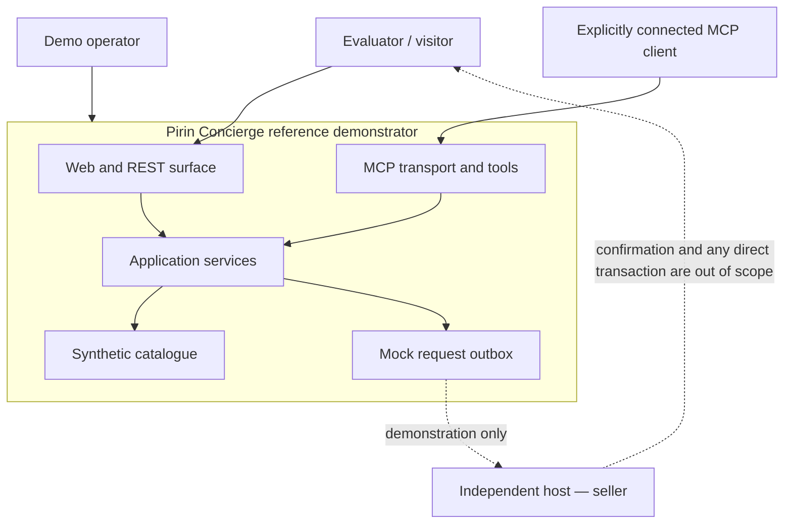
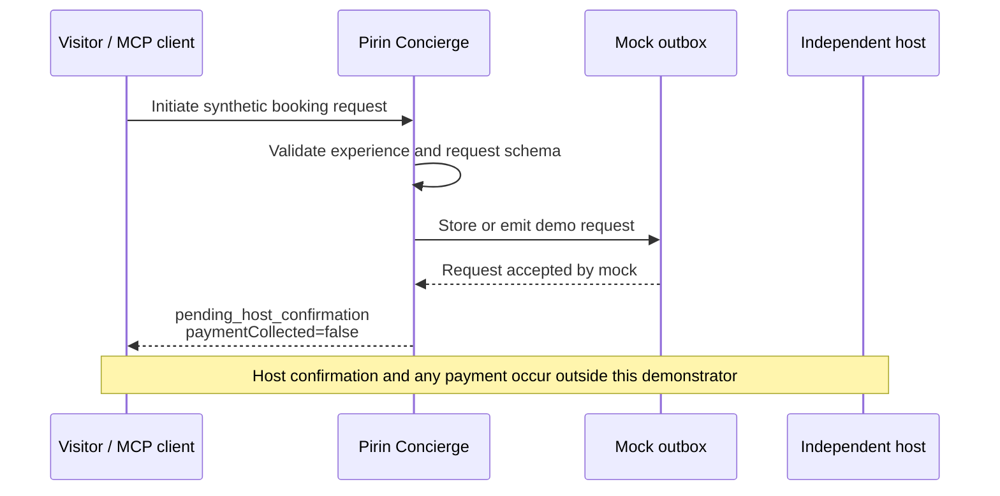

# Reference architecture

## Document status

This document describes the intended architecture of the application-stage laboratory demonstrator. It is not proof that every component has been implemented, deployed, or verified. Release-specific observations belong in [`trl4-evidence.md`](trl4-evidence.md).

## Design objectives

Pirin Concierge is designed to demonstrate a narrow technical chain:

1. publish a small synthetic catalogue of rural experiences;
2. expose the same catalogue through web/REST, OpenAPI, JSON-LD, and MCP;
3. ground concierge results in identifiable catalogue records;
4. initiate an expression of interest that requires host confirmation;
5. make it technically clear that no payment or confirmed booking occurs.

The architecture favours a self-contained, reproducible reference service over production-scale complexity.

## System context



An AI or chat client does not discover Pirin Concierge automatically. For an MCP demonstration, the client must be deliberately configured to connect to this MCP server.

## Logical components

| Component | Responsibility | Persistent state in the public demo |
|---|---|---|
| Catalogue loader | Load and validate synthetic experience records | Checked-in synthetic files only |
| Search service | Filter/rank records using declared catalogue fields | None expected |
| Experience service | Return one stable record by identifier | None expected |
| Area listing | Return experiences for a supported locality | None expected |
| REST adapter | Expose health, catalogue, search, and booking-request endpoints | None expected |
| OpenAPI document | Describe and validate the public HTTP contract | Checked-in specification |
| MCP adapter | Expose four typed tools over supported MCP transport(s) | Session state only where required by the SDK |
| JSON-LD presenter | Map catalogue records to Schema.org entities | None expected |
| Concierge | Return catalogue-grounded suggestions with record references | None expected |
| Booking-request handler | Validate a synthetic request and send non-personal routing evidence to a mock outbox | Current design is process memory only; verify the release |
| Mock outbox | Make request delivery visible without contacting a real host or retaining visitor details | Current design is process memory only; verify deployment/log behaviour |

The current implementation and schemas are authoritative. Any difference between this design and the code must be resolved or documented before release.

## Interface contracts

### REST/OpenAPI

The intended surface is:

- `GET /health`
- `GET /api/v1/experiences`
- `GET /api/v1/experiences/{id}`
- `GET /api/v1/experiences/search`
- `POST /api/v1/concierge/search`
- `POST /api/v1/booking-requests`
- `GET /api/v1/demo/outbox`
- `GET /openapi.yaml`
- `/mcp` for the MCP HTTP transport

`openapi/openapi.yaml` is the contract source of truth for a release. Runtime responses should be tested against it.

### MCP

The intended tools are:

| Tool | Side effect | Purpose |
|---|---:|---|
| `search_experiences` | No | Search the synthetic catalogue with typed filters. |
| `get_experience` | No | Retrieve one record by stable identifier. |
| `list_by_area` | No | List records for a supported locality. |
| `initiate_booking_request` | Yes, limited | Create a synthetic expression of interest in the mock outbox. |

The MCP server should use the official TypeScript SDK and support a standards-compliant handshake, tool discovery, and tool invocation. The evidence package must identify the SDK, server version, client, transport, and exact calls used.

## Data flow

### Discovery flow

1. A visitor or MCP client supplies structured search criteria.
2. The adapter validates input and calls the catalogue service.
3. The service searches only validated synthetic records.
4. The response includes stable record identifiers so a result can be inspected and cited.
5. A web presentation may add JSON-LD generated from the same record.

Catalogue descriptions are data, not instructions. They must never override system rules or cause arbitrary tool execution.

### Booking-request flow



Required response invariants:

```text
status = pending_host_confirmation
requiresHostConfirmation = true
paymentCollected = false
automaticallyConfirmed = false
```

There is no path from the request handler to a payment provider, inventory lock, or automatic confirmation service.

## Trust boundaries

1. **Public input boundary:** HTTP and MCP parameters are untrusted and schema-validated.
2. **Catalogue boundary:** only checked-in, reviewed synthetic records are trusted as catalogue data; their free text remains non-executable.
3. **Client boundary:** MCP clients and browsers are separate systems with their own logs and privacy behaviour.
4. **Mock outbox boundary:** request payloads must remain synthetic; actual retention and visibility require deployment verification.
5. **Repository boundary:** proprietary Calivina systems and real host/customer data are external and excluded.

See [`threat-model.md`](threat-model.md) for abuse cases and verification requirements.

## Deployment profile

The reference implementation should run locally from a clean clone and may be deployed as a stateless Node/edge service. Environment-specific values belong in environment variables, never committed files. A public deployment is optional evidence and must have:

- a stable release commit and build provenance;
- HTTPS and least-privilege configuration;
- explicit synthetic-data notice;
- bounded input size and rate controls;
- verified log redaction and retention;
- no production credentials or connections;
- a health endpoint that reveals no secrets.

Exact hosting, region, subprocessor, retention, and availability statements are `TODO` until observed and recorded.

## Architecture decisions

| Decision | Rationale |
|---|---|
| One bounded reference service | Reduces setup and evidence complexity at TRL 4. |
| Synthetic file-based catalogue | Supports reproducibility and removes real-person/data-right risks from the public baseline. |
| Common domain service behind REST and MCP | Prevents inconsistent business rules between channels. |
| Host remains `seller` | Preserves the commercial and legal boundary of a discovery/request-routing service. |
| Request-only state transition | Demonstrates hand-off without claiming booking or payment infrastructure. |
| Official MCP SDK | Avoids a private JSON-RPC dialect and enables standard client verification. |
| Provider-neutral concierge boundary | Keeps catalogue access reproducible and avoids making one model vendor necessary for evaluation. |

## Explicit non-goals

- production booking, availability guarantees, or inventory locking;
- payment processing, checkout, refunds, escrow, or marketplace settlement;
- production identity, authentication, CRM, tenant administration, analytics, or billing;
- scraping or importing real host data without permission;
- publishing the complete proprietary Calivina platform;
- claiming production readiness or TRL 5/6 validation.
