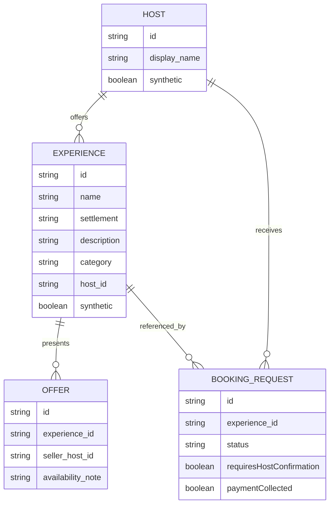
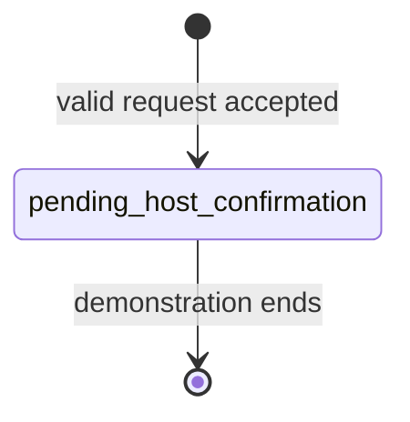

# Data model

## Status and authority

This document explains the conceptual model. The checked-in JSON Schemas, OpenAPI specification, and MCP input/output schemas are authoritative for exact field names, types, constraints, and required properties on a given commit. Differences must be resolved before release.

All records in the public baseline are synthetic.

## Core concepts



An implementation may embed `Host` and `Offer` inside an experience record rather than store separate collections. The semantic relationships and safety invariants remain the same.

## Experience

An `Experience` is a discoverable rural activity or visit. Useful fields include:

- stable, URL-safe identifier;
- public `name` and concise `description`;
- `settlement`, such as Bansko, Razlog, Banya, or Dobarsko;
- `category`, `languages`, `durationMinutes`, indicative price, and by-request availability note;
- a synthetic host reference;
- one or more offer/availability descriptions;
- source/provenance indicator and `synthetic: true` marker;
- optional public URL and structured-data representation.

Descriptions should be factual, short, and safe to display. They are catalogue data, never executable instructions for an LLM or MCP client.

## Host and seller

A `Host` is the independent provider responsible for the experience. In Schema.org output the host is the `seller` of the related `Offer`.

The public dataset uses fictional display names and non-routable or reserved contact information, if contact information is necessary at all. A Pirin Concierge operator is not represented as the seller and does not accept payment on the host's behalf.

## Offer

An `Offer` communicates that an experience may be requested under stated conditions. In the TRL 4 demonstrator:

- it does not guarantee live inventory;
- it does not constitute an accepted contract or confirmed reservation;
- price information, if synthetic and present, is illustrative;
- payment cannot be submitted;
- the offer's seller is the host;
- availability is subject to host confirmation.

## Booking request

A `BookingRequest` is a synthetic expression of interest linked to one experience. It is not a booking record.

The minimum domain invariants are:

```text
status: pending_host_confirmation
requiresHostConfirmation: true
paymentCollected: false
automaticallyConfirmed: false
```

A request may contain a synthetic date/time preference, party size, language, and fixed demonstration requester identity. Free text should be optional, tightly bounded, and treated as untrusted. Payment-card, bank, identity-document, health, or real contact data is prohibited in the public demonstration.

### State model



There is deliberately no `confirmed`, `paid`, `refunded`, `cancelled_by_platform`, or inventory-hold transition in the reference flow. A host's later response and any direct transaction are outside the demonstrator.

## Schema.org/JSON-LD mapping

The presentation layer should derive JSON-LD from the same validated catalogue record used by REST and MCP.

| Domain concept | Candidate Schema.org type/property |
|---|---|
| Experience | `TouristAttraction`, `Event`, or another documented compatible type |
| Title | `name` |
| Description | `description` |
| Locality | `location` / `addressLocality` |
| Category/theme | `touristType`, `keywords`, or documented mapping |
| Offer | `offers` / `Offer` |
| Independent host | `Offer.seller` as `Organization` or `Person` |
| Request entry point | `potentialAction` or documented request URL, without implying confirmation/payment |

Contract tests should confirm that every public experience page emits parseable JSON-LD and that `Offer.seller` resolves to the host rather than Pirin Concierge.

## Search and grounding

Search and concierge responses should return stable experience identifiers and sufficient source fields for an evaluator to inspect the originating record. A generated answer must not invent availability, prices, accessibility guarantees, host identity, confirmation, or payment status.

When no record satisfies a request, the safe result is an empty or qualified answer, not fabrication.

## Validation rules

Before release, automated validation should demonstrate that:

- every demo record validates against the checked-in schema;
- identifiers are unique and references resolve;
- localities and enumerated fields use supported values;
- the synthetic marker is present where required;
- no obvious personal contact data, secrets, or production URLs appear;
- REST, MCP, and JSON-LD views preserve the same record identity;
- booking responses preserve all request-only invariants.

Observed validation output belongs in [`trl4-evidence.md`](trl4-evidence.md).

## Provenance, licensing, and versioning

The demonstration dataset is original synthetic material licensed as described in [`../NOTICE.md`](../NOTICE.md). Its README should state generation/review methodology, version, supported localities, known limitations, and attribution.

Breaking schema changes should be versioned and reflected consistently in OpenAPI, MCP tools, examples, tests, and changelog. Historical public evidence should remain tied to immutable release tags and commit identifiers.

## Pilot transition

Real host content must not be mixed into the public synthetic catalogue by default. TRL 5/6 pilot data requires permission, provenance, a privacy/legal basis, access controls, retention rules, correction/removal procedures, and separate publication decisions. See [`trl4-to-trl6-roadmap.md`](trl4-to-trl6-roadmap.md).
