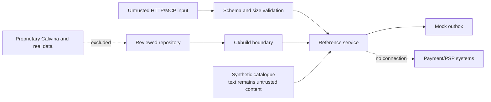

# Threat model

## Status and method

This is a design-time threat model for the public reference demonstrator. Controls labelled “required” or “planned” must not be described as implemented until verified on a release commit and, where relevant, its deployment. Evidence status is maintained in [`trl4-evidence.md`](trl4-evidence.md).

Review triggers include a new external integration, real participant data, authentication, persistence, a model provider, a public deployment, or any booking/payment scope change.

## Protected assets

- integrity of the synthetic catalogue, schemas, OpenAPI document, and MCP tool contracts;
- correctness of grounded recommendations and record provenance;
- the request-only invariant and host-as-seller boundary;
- repository, build, release, and deployment credentials;
- availability of the bounded laboratory demo;
- privacy of operators/evaluators and absence of real personal data;
- integrity of public evidence and maturity claims;
- proprietary Calivina assets outside the repository.

## Actors

- evaluator or visitor using REST/web interfaces;
- explicitly configured MCP client and its operator;
- repository contributor/maintainer;
- demo deployment operator;
- attacker sending malformed or high-volume input;
- compromised dependency, contributor account, workflow, or build environment;
- future authorised host/community participant, outside the TRL 4 public-data baseline.

## Trust boundaries

## Key abuse cases and required controls

| ID | Threat / failure mode | Impact | Required or planned control | Release verification |
|---|---|---|---|---|
| T01 | Malformed, oversized, or unexpected API/MCP input | Crash, resource exhaustion, contract bypass | Typed schemas, strict validation, bounded lengths/arrays, safe errors | `TODO` |
| T02 | Catalogue text contains prompt/tool instructions | Manipulated concierge output or tool use | Treat catalogue as quoted data, fixed system policy, allowlisted tools, record grounding, adversarial tests | `TODO` |
| T03 | Query or identifier causes injection/path traversal | Data exposure or arbitrary execution | No dynamic code/shell evaluation; safe lookups; reject unsupported identifiers | `TODO` |
| T04 | User infers that a request is confirmed or paid | Consumer/commercial harm | Fixed pending status, explicit host confirmation, `paymentCollected=false`, negative contract tests | `TODO` |
| T05 | Payment fields or PSP integration enter the reference flow | Scope/legal/security escalation | Schemas and tests prohibit payment credentials and payment/checkout endpoints | `TODO` |
| T06 | Real personal data is submitted or logged | Privacy breach | Synthetic-only UI notice/data, fixed demo identity, body-log suppression, redaction, bounded retention | `TODO` |
| T07 | Booking-request spam or denial of service | Demo/outbox unavailable or noisy | Rate/size limits, idempotency where appropriate, bounded mock storage, deployment quotas | `TODO` |
| T08 | Error/health response reveals internals or secrets | Reconnaissance/credential exposure | Generic client errors, server-side safe diagnostics, minimal health response | `TODO` |
| T09 | Dependency or build-workflow compromise | Malicious release/code execution | Lockfile, minimal permissions, dependency review, CodeQL/static checks, SBOM, pinned actions | `TODO` |
| T10 | Secret committed in current or historical Git data | Account/infrastructure compromise | Fresh public history, `.gitignore`, push protection, automated history scan, rotation procedure | `TODO` |
| T11 | Unauthorised/unlicensed content is published | Privacy, copyright, reputational harm | Allowlist-only source import, provenance review, synthetic assets, release checklist | `TODO` |
| T12 | MCP client/server incompatibility or tool spoofing | Misleading demo or wrong action | Official SDK, explicit server connection, tool schemas, named client/version/transport, integration test | `TODO` |
| T13 | External URL fetching introduces SSRF/tracking | Internal access or privacy leak | Do not fetch catalogue URLs server-side; allowlist if capability is later added | `TODO` |
| T14 | Cross-origin/browser abuse on a public deployment | Unauthorised requests or data exposure | Narrow CORS, content-type checks, no credentials by default, security headers | `TODO` |
| T15 | Evidence or KPI is fabricated/stale | Evaluator deception and trust loss | Immutable SHA/tag, dated raw output, checksums, explicit TODO/pending states | `TODO` |
| T16 | Proprietary Calivina material leaks into repository | IP, privacy, security harm | Clean-room bounded implementation, file allowlist, maintainer review, secret/PII/licence scans | `TODO` |

## MCP and concierge-specific rules

- Tool names and schemas are fixed by the release; the client cannot define new server-side tools.
- Search/retrieval results expose stable source-record identifiers.
- Catalogue/free-text input cannot modify safety instructions or invoke `initiate_booking_request` implicitly.
- A side-effecting request requires explicit, schema-valid invocation and returns the request-only status.
- Tool errors do not contain stack traces, environment values, or unrelated records.
- If an optional LLM adapter is used, no real personal data is sent, model output is treated as untrusted, and deterministic catalogue-grounding tests remain available without the provider.

## Privacy analysis

The laboratory baseline avoids real personal data. This reduces but does not eliminate risk: IP addresses, platform logs, GitHub identities, and accidental free-text submissions may still identify people. Before any public deployment, document actual logging, retention, access, hosting region, subprocessors, and deletion procedures. Before TRL 5/6, complete a separate data-protection assessment for real participants.

## Security acceptance gate

Before public release, evidence should show:

- clean secret scan across the complete fresh repository history;
- allowlist review for personal, confidential, and unlicensed content;
- automated tests for validation and all booking-request invariants;
- OpenAPI, JSON Schema, JSON-LD, and MCP contract checks;
- dependency/static analysis with no unresolved high or critical issue;
- least-privilege CI/repository settings and private vulnerability reporting;
- public demo rate/size bounds, safe errors, and verified log behaviour;
- incident contact and rollback/removal procedure;
- evidence artefacts tied to an immutable commit.

Any exception requires an explicit risk owner, rationale, compensating control, and deadline. An unresolved issue capable of exposing secrets/personal data, collecting payment, confirming bookings, or executing arbitrary input blocks publication.

## Residual risk and non-claims

Passing laboratory checks does not establish production security, continuous availability, legal compliance for all jurisdictions, or safety under real-world scale. A public demo should be treated as disposable and isolated from production systems. TRL 5/6 introduce new participants, data, operations, and threats and therefore require a new review.
