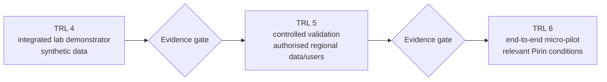

# Evidence roadmap: TRL 4 to TRL 6

## Status

This is a proposed maturity and validation plan. Targets, participant counts, timings, and KPIs are not achieved results or contractual commitments. They should be confirmed with the Community Activator, Pilot Orchestrator, hosts, mentors, and applicable SMART ERA guidance before execution.

The intended progression follows the usual European TRL distinction:

- **TRL 4:** technology validated in a laboratory setting;
- **TRL 5:** technology validated in a relevant environment;
- **TRL 6:** technology demonstrated in a relevant environment.

Repository publication alone can support a TRL 4 evidence package; it cannot establish TRL 5 or TRL 6.

## Application-aligned participation targets

These are the planned programme targets to be measured, not current achievements:

| Period | Planned operational target | Maturity purpose |
|---|---|---|
| Months 1–2 | Approximately 10 anchor hosts onboarded | Establish the authorised catalogue and co-design/validation baseline. |
| Months 3–5 | At least 15 hosts live and at least 70 cumulative session attendances | Validate the integrated prototype and host/user workflows in relevant controlled conditions. |
| Months 6–12 | At least 25 hosts across 3–5 settlements, with at least 50% women-led hosts | Demonstrate the prototype in the relevant regional environment and produce the TRL 6 Technical Solution Report. |

“Cumulative session attendances” must be measured consistently and reported separately from unique people. “Live host” and “women-led host” definitions, evidence sources, consent, and denominators must be fixed before measurement.

## Maturity path



## Stage 1 — Establish the TRL 4 baseline

### Objective

Integrate and validate the reference components under controlled laboratory conditions without real host/customer data or financial transactions.

### Technical scope

- validated synthetic catalogue representing several Pirin localities;
- REST/OpenAPI and Schema.org/JSON-LD views of the same records;
- standard MCP connection and four typed tools;
- catalogue-grounded concierge results with inspectable identifiers;
- synthetic request routed to a mock outbox;
- hard request-only invariant: host confirmation required, no payment collected;
- reproducible installation, tests, build, security baseline, and evidence release.

### Exit evidence

- all gates in [`trl4-evidence.md`](trl4-evidence.md) observed on one commit;
- prerelease `v0.1.0-trl4` with source, test reports, OpenAPI, SBOM, checksums, video, and transcript;
- clean-clone reproduction by a person other than the primary implementer;
- limitations and failed/skipped checks disclosed.

**Decision:** proceed only if the integrated chain is reproducible and the request cannot become paid or automatically confirmed.

## Stage 2 — TRL 4 to TRL 5 validation

Planned validation period: months 1–5 after the verified laboratory baseline, with onboarding in months 1–2 and live validation in months 3–5.

### Objective

Validate the technology with authorised, representative Pirin content and users in a controlled environment that reflects regional language, device, connectivity, and host workflow conditions.

### Preparation gate

Before handling real participant data:

- appoint accountable pilot roles and establish host/participant agreements;
- complete privacy, ethics, security, and data-management assessments;
- create transparent notices, consent/participation records where appropriate, retention/deletion rules, and incident procedures;
- separate pilot data and infrastructure from the public synthetic demo;
- define a support route and rollback plan;
- preregister success metrics, sampling limits, and evidence-publication rules.

### Proposed cohort and activities

- approximately 10 anchor hosts onboarded in months 1–2;
- at least 15 hosts live by the months 3–5 validation phase;
- at least 70 cumulative session attendances by the end of month 5;
- a permissioned catalogue sized to the participating hosts and validation scenarios;
- representative users, with diversity considered in recruitment and analysis;
- Bulgarian and English journeys;
- two structured co-design/validation workshops;
- typical mobile devices and constrained-connectivity scenarios;
- real host notification in a controlled pilot channel, while confirmation/payment stay direct with the host;
- accessibility and failure-recovery tasks, not only the happy path.

These are planning targets. The final participant/sample design and the meaning of each attendance metric must be documented and must not be treated as statistically representative of the whole region.

### Proposed TRL 5 acceptance targets

| Measure | Proposed threshold | Evidence method |
|---|---:|---|
| Successful API/MCP calls in scripted scenarios | ≥95% | Timestamped automated/observational log |
| Users completing core discovery-to-request task | ≥80% | Moderated task protocol |
| Valid requests delivered to intended pilot host channel | ≥95% | Reconciled request/notification log |
| Complete, schema-valid catalogue records | ≥90% | Automated validation plus content review |
| System Usability Scale | ≥70 | Anonymised questionnaire and method |
| Payment/automatic confirmation by platform | 0 | Negative contract and workflow audit |
| Unresolved high/critical security findings | 0 | Dated scan and review report |
| Material personal-data incident | 0 | Incident register |

Thresholds should be finalised before testing. Report confidence, missing data, deviations, and qualitative findings; do not convert a small convenience sample into a population claim.

### Deliverables

- `TRL 5 Validation Protocol` approved before participant testing;
- data-management/privacy/security record;
- anonymised/coarsened test dataset and metric definitions where publishable;
- `TRL 5 Validation Report` with raw-evidence references, deviations, failures, and corrective actions;
- a release candidate tied to the tested commit and environment;
- go/no-go decision for broader demonstration.

**TRL 5 gate:** the technology, not merely the concept, works with representative data and workflows in controlled relevant conditions. Significant failures return to remediation and repeat validation.

## Stage 3 — TRL 5 to TRL 6 demonstration

Planned demonstration period: months 6–12, after the TRL 5 gate.

### Objective

Demonstrate an integrated prototype end to end during a time-bounded micro-pilot under relevant operating conditions in the Pirin area.

### Proposed pilot envelope

- at least 25 active hosts by the end of the demonstration period;
- participating hosts distributed across 3–5 Pirin settlements;
- at least 50% of participating hosts women-led, using a predeclared and consistently evidenced definition;
- a permissioned live catalogue reflecting the participating hosts;
- monitored operation during the months 6–12 pilot window;
- concierge sessions and valid booking requests tracked using predeclared definitions and denominators;
- trained Community Activator and host users;
- explicit MCP client demonstration and at least one independent OpenAPI integration;
- support, monitoring, audit events, backup/recovery test, and incident exercise.

These are proposed evidence targets, not claimed achievements or automatic proof of external validity.

### End-to-end scenario

```text
participant need
  → grounded catalogue search
  → inspect permissioned host offer
  → initiate request
  → notify intended host
  → host responds directly
  → outcome recorded with minimal authorised data
```

The platform still does not collect payment or automatically confirm. The independent host remains seller and decides availability and any subsequent direct transaction.

### Proposed TRL 6 acceptance targets

| Measure | Proposed threshold | Evidence method |
|---|---:|---|
| Pilot service availability during declared service window | ≥98% | Monitoring definition and raw uptime events |
| Technical success of eligible end-to-end request flow | ≥95% | Reconciled session/request/notification records |
| Participants finding at least one suitable catalogue item in the measured task | ≥80% | Defined task and anonymised session outcome |
| Participating hosts rating the core workflow easy/acceptable | ≥70% | Post-pilot questionnaire/interview protocol |
| Participating hosts willing to continue or extend use | ≥60% | Post-pilot response, denominator reported |
| Critical defects at pilot close | 0 open | Issue/evidence register |
| Material privacy/security incidents | 0 | Incident register and post-pilot review |
| Platform payment or automatic confirmation | 0 | Architecture, contract, and event-log audit |

Availability and success denominators, exclusions, maintenance windows, and missing responses must be declared before calculation.

### Demonstration evidence

- approved pilot protocol and acceptance criteria;
- exact release/deployment identity and configuration record;
- participant/host evidence retained privately under appropriate controls;
- anonymised technical logs and metric calculations;
- accessibility, usability, security, recovery, and operational-support findings;
- recorded representative end-to-end demonstration with consent;
- issue/change register connecting findings to fixes and retests;
- scalability and sustainability observations, including actual support workload;
- the application-aligned `TRL 6 Technical Solution Report` and release `v0.6.0-trl6` tied to the tested commit.

**TRL 6 gate:** a representative integrated prototype has been demonstrated in relevant conditions with traceable evidence. A polished video, repository, or isolated test does not replace that evidence.

## Workstream progression

| Workstream | TRL 4 | TRL 5 | TRL 6 |
|---|---|---|---|
| Data | Synthetic records | Permissioned representative pilot data | Operational pilot catalogue with governed updates |
| Users | Developers/evaluators | Small controlled host/user cohort | Multi-locality participant cohort and operators |
| Environment | Local/isolated demo | Controlled relevant devices/connectivity/workflows | Time-bounded relevant-environment operation |
| Integration | REST, JSON-LD, MCP, mock outbox | Real pilot notification channel | Independent API consumer and operational host hand-off |
| Privacy/security | No intended personal data; design controls | Assessed real-participant processing | Monitored controls, incident and recovery exercise |
| Operations | Reproducible start/test | Facilitated validation support | Defined service window, monitoring, support, rollback |
| Evidence | Commit-level lab record | Validation protocol/report | Demonstration protocol/report and metric archive |

## Governance and review points

At each gate, the technical lead, Community Activator, privacy/security reviewer, and pilot owner should jointly review:

- whether the environment is relevant to the claimed level;
- whether evidence comes from the named version and complete scenario;
- whether recruitment and analysis account for gender and accessibility without exposing participants;
- whether negative results and excluded observations are visible;
- whether host/seller and request-only boundaries remain accurate;
- whether the next stage introduces new legal, ethical, safety, or operational obligations;
- whether public evidence is sufficiently anonymised and licensed.

## Stop conditions

Pause or roll back the pilot for:

- payment collection or automatic confirmation entering the flow unintentionally;
- exposure of personal data, credentials, or private partner material;
- an unresolved high/critical vulnerability affecting the pilot;
- unreliable routing that could materially mislead visitors or hosts;
- missing authority to use host content or participant data;
- evidence that the claimed environment or integration is not representative.

## What TRL 6 does not mean

TRL 6 is not synonymous with a mature commercial marketplace. Production-scale reliability, regulated payment operations, sustained business performance, contractual service levels, multi-region scale, and a fully qualified operational system belong to later product and maturity decisions.
